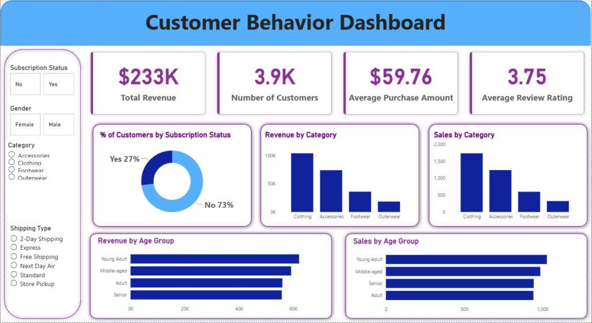
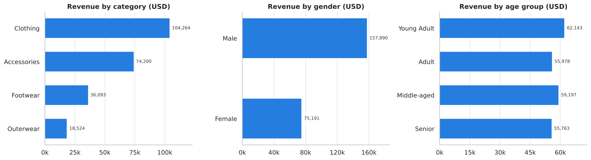
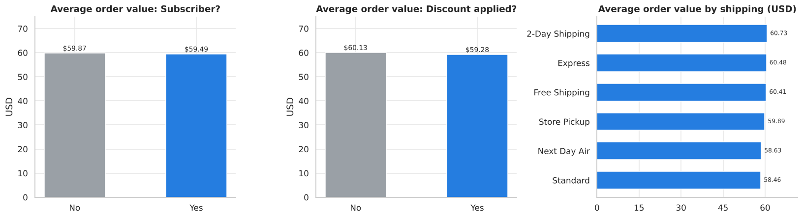
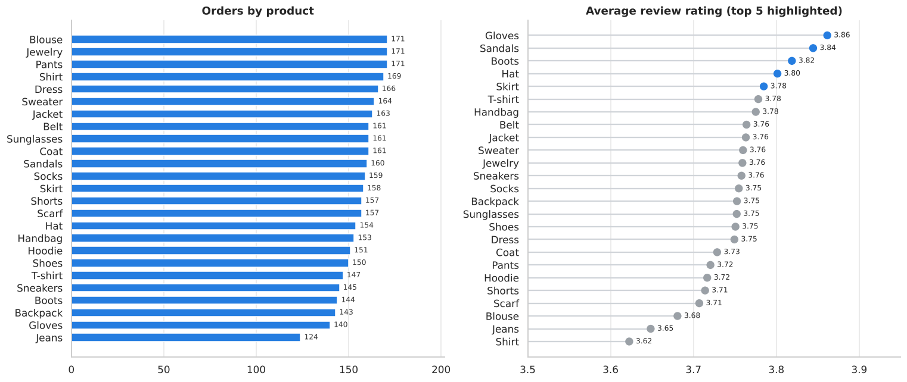
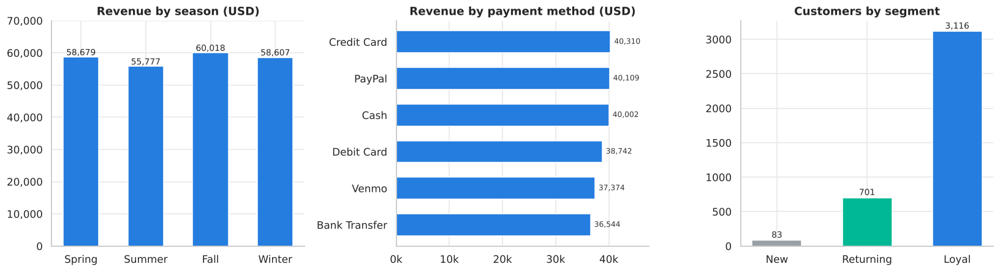

# Customer Shopping Behavior Analysis: Retail Sales

**Python · Pandas · SQL (SQLite / PostgreSQL) · Power BI · Matplotlib · Seaborn · Jupyter**



*Power BI dashboard: [`powerbi/customer_shopping_behavior_dashboard.pbix`](powerbi/customer_shopping_behavior_dashboard.pbix)*

---

## Contents
[Problem statement](#problem-statement) · [Objectives](#objectives) · [Dataset](#dataset) · [What I did](#what-i-did-step-by-step) · [SQL business questions](#sql-business-questions) · [Power BI dashboard](#power-bi-dashboard) · [Analysis charts](#analysis-charts) · [Key findings](#key-findings) · [Recommendations](#recommendations) · [Project summary](#project-summary) · [Repository structure](#repository-structure) · [How to run](#how-to-run)

---

## Problem statement
A retail company wants to understand its customers' shopping behaviour so it can grow sales, improve customer satisfaction and build long-term loyalty. Management has seen purchasing patterns shift across demographics, product categories and shipping options, and wants to know which factors (discounts, reviews, seasons, subscriptions, payment preferences) drive spending and repeat purchases.

**Business question:** *How can the company use its customer shopping data to identify trends, improve customer engagement and optimise its marketing and product strategy?*

## Objectives
- Clean and prepare the raw data in Python, and document every data-quality issue.
- Engineer features for analysis: age groups, purchase frequency in days, customer segments.
- Explore revenue, products, customers and spending drivers with clear charts.
- Load the clean table into a SQL database and answer the business questions with SQL.
- Build a dashboard that lets stakeholders filter and explore the results.
- Turn the results into findings and actionable recommendations.

## Dataset
**3,900 purchases, 18 columns**, one row per customer (`data/raw/customer_shopping_behavior.csv`).

| Group | Columns |
|---|---|
| Customer | Customer ID, Age, Gender, Location (US state), Subscription Status |
| Purchase | Item Purchased, Category, Purchase Amount (USD), Size, Color, Season |
| Behaviour | Review Rating, Shipping Type, Discount Applied, Promo Code Used, Previous Purchases, Payment Method, Frequency of Purchases |

## What I did (step by step)
| # | Step | What was done | Where |
|---|---|---|---|
| 1 | **Setup** | Python environment, file paths, one consistent chart style and colour palette. | Notebook intro |
| 2 | **Load and inspect** | Read the CSV with Pandas; checked structure with `info()` and summary statistics with `describe()`. | §1 |
| 3 | **Data-quality audit** | Found 37 missing review ratings; confirmed there are no duplicates; found that `Promo Code Used` repeats `Discount Applied` on every row; found two pairs of same-meaning frequency labels (Bi-Weekly / Fortnightly, Quarterly / Every 3 Months); found that discounts and subscriptions appear only for male customers. | §2 |
| 4 | **Cleaning** | Filled missing ratings with the median of the same product category; renamed columns to `snake_case`; dropped the redundant promo-code column. | §3 |
| 5 | **Feature engineering** | `age_group` (four quartile groups), `purchase_frequency_days`, and `customer_segment` (New / Returning / Loyal). Saved to `data/processed/customer_shopping_clean.csv`. | §4 |
| 6 | **Exploratory analysis** | KPIs; revenue by category, gender and age group; order value by subscription, discount and shipping; product sales and ratings; seasons, payment methods and segments; correlation heatmap. | §5 |
| 7 | **SQL analysis** | Loaded the clean table into SQLite and answered 13 business questions (aggregations, subqueries, `CASE`, CTEs and the `ROW_NUMBER()` window function). Queries are in `sql/business_queries.sql` and also run on PostgreSQL. | §6 |
| 8 | **Power BI dashboard** | Imported the clean data into Power BI, created DAX measures (Total Revenue, Number of Customers, Average Purchase Amount, Average Review Rating) and built a one-page report: KPI cards, slicers for subscription, gender, category and shipping type, and charts by subscription, category and age group. | `powerbi/` |
| 9 | **Findings and recommendations** | Written conclusions for the business, including the data caveat. | §8–9 |
| 10 | **Report** | A short project report for stakeholders (`reports/project_report.md`). | `reports/` |

## SQL business questions
| # | Question | Answer |
|---|---|---|
| Q1 | Revenue by gender | Male USD 157,890 (67.7%), Female USD 75,191 (32.3%) |
| Q2 | Discount users who still spent above average | 839 customers, average order USD 79.79 (overall USD 59.76) |
| Q3 | Top 5 products by rating | Gloves 3.86, Sandals 3.84, Boots 3.82, Hat 3.80, Skirt 3.78 |
| Q4 | Average order: Standard vs Express shipping | Express USD 60.48 vs Standard USD 58.46 |
| Q5 | Do subscribers spend more? | No: USD 59.49 vs 59.87 per order |
| Q6 | Products most often bought with a discount | Hat 50.0%, Sneakers 49.7%, Coat 49.1%, Sweater 48.2%, Pants 47.4% |
| Q7 | Customer segments | Loyal 3,116 · Returning 701 · New 83 |
| Q8 | Top 3 products per category | Accessories: Jewelry, Belt, Sunglasses · Clothing: Blouse, Pants, Shirt · Footwear: Sandals, Shoes, Sneakers · Outerwear: Jacket, Coat |
| Q9 | Do repeat buyers subscribe more? | Slightly: 27.6% vs 22.4% for occasional buyers |
| Q10 | Revenue by age group | Young Adult 26.7%, Middle-aged 25.4%, Adult 24.0%, Senior 23.9% |
| Q11 | Revenue by season | Fall USD 60,018 (highest), Summer USD 55,777 (lowest) |
| Q12 | Data check: discounts and subscriptions by gender | Female 0% / 0%, Male 63.2% / 39.7% |
| Q13 | Top 5 states by revenue | Montana, Illinois, California, Idaho, Nevada |

## Power BI dashboard
`powerbi/customer_shopping_behavior_dashboard.pbix` is a one-page Power BI report built on the cleaned data:

| Element | Content |
|---|---|
| KPI cards | Total Revenue ($233K) · Number of Customers (3.9K) · Average Purchase Amount ($59.76) · Average Review Rating (3.75) |
| Slicers | Subscription Status · Gender · Category · Shipping Type |
| Charts | % of Customers by Subscription Status · Revenue by Category · Sales by Category · Revenue by Age Group · Sales by Age Group |

DAX measures:
```DAX
Total Revenue           = SUM(customer[purchase_amount])
Number of Customers     = DISTINCTCOUNT(customer[customer_id])
Average Purchase Amount = AVERAGE(customer[purchase_amount])
Average Review Rating   = AVERAGE(customer[review_rating])
```
Filtering to subscribers shows USD 62,645 revenue, 1,053 customers and a USD 59.49 average purchase, the same figures as SQL Q5.

**To open it:** install [Power BI Desktop](https://www.microsoft.com/power-bi/desktop) (free) and open `powerbi/customer_shopping_behavior_dashboard.pbix`. The source version (`Customer Shopping Behavior.pbip`, a Power BI Project) reads `data/processed/customer_shopping_clean.csv`; if your copy of the repo is in a different folder, change the `DataFolder` parameter in *Transform data → Manage parameters*, or regenerate it with `python src/build_powerbi.py "<your path>\data\processed"`.

## Analysis charts
Charts from the Python exploratory analysis in the notebook:

| Revenue breakdown | Spending drivers |
|---|---|
|  |  |

| Products and ratings | Seasons, payments and segments |
|---|---|
|  |  |

## Key findings
1. **Revenue is concentrated in two categories.** Clothing (44.7%) and Accessories (31.8%) bring in 76.5% of the USD 233,081 total. Outerwear is only 7.9%.
2. **Order size is flat everywhere.** The average order stays around USD 58–62 across gender, age group, season, shipping, subscription and discount, and no numeric column correlates with spend. Growth has to come from **more orders and more customers**, not bigger baskets.
3. **Subscriptions are not lifting spend.** 27% of customers subscribe, but subscribers spend slightly less per order (USD 59.49 vs 59.87). Repeat buyers subscribe a little more often (27.6% vs 22.4%), yet 72% of them still have not subscribed.
4. **Discounts are used on 43% of orders** without a gain in basket size. Hats, Sneakers and Coats are discounted almost half the time.
5. **The customer base is mature.** 80% of customers have more than 10 previous purchases; only 83 customers (2%) are new.
6. **Fall is the best season** (USD 60,018, highest average order of USD 61.56); Summer is the weakest (USD 55,777).
7. **Ratings are average across the range:** every product sits between 3.62 and 3.86 out of 5.

> **Data caveat:** in this dataset, discounts and subscriptions are recorded only for male customers. That is unlikely in a real business, so gender comparisons on those two factors are not reliable and are flagged rather than used for decisions.

## Recommendations
- **Rework the subscription offer.** It does not lift spend today. Test member perks tied to bigger baskets, such as free express shipping above a threshold or early access to new collections, and target the 72% of repeat buyers who have not subscribed.
- **Tighten discounts on the most-discounted items** (Hats, Sneakers, Coats, Sweaters, Pants) and measure whether sales hold.
- **Invest in acquisition.** With only 2% new customers, growth depends on new buyers; Young Adults (18–31) are the largest revenue group to target.
- **Plan stock and campaigns around Fall**, and use Summer promotions to lift the weakest season.
- **Feature top-rated products** (Gloves, Sandals, Boots) in campaigns, and collect review text to learn why ratings sit near 3.75.
- **Fix data collection** so discounts and subscriptions are tracked for all customers, then repeat the gender analysis.

## Project summary
I took a raw retail dataset of 3,900 purchases through a complete analytics workflow: cleaning and feature engineering in **Python**, answering 13 business questions in **SQL**, and presenting the results in a **Power BI dashboard**. The analysis shows that revenue depends on two categories and on a mature, loyal customer base, while subscriptions and discounts are not increasing how much customers spend per order. It also shows the value of checking the data before trusting it: the gender pattern in discounts and subscriptions is a data issue, not a customer insight.

**Skills shown:** data cleaning, missing-value imputation, feature engineering, exploratory data analysis, SQL (aggregations, subqueries, CTEs, window functions), data visualisation, Power BI (DAX measures, slicers, report design), dashboard design and business communication.

## Repository structure
```
customer-shopping-behavior-analysis/
├── data/
│   ├── raw/customer_shopping_behavior.csv       # original data (3,900 × 18)
│   └── processed/
│       ├── customer_shopping_clean.csv          # cleaned + engineered features
│       └── customer_behavior.db                 # SQLite database used by the SQL step
├── notebooks/shopping_behavior_analysis.ipynb   # full analysis (Python + SQL)
├── sql/business_queries.sql                     # 13 business questions
├── src/
│   ├── build_powerbi.py                         # builds the Power BI Project
│   └── powerbi_template/                        # report layout and theme
├── powerbi/
│   ├── customer_shopping_behavior_dashboard.pbix  # Power BI dashboard
│   └── Customer Shopping Behavior.pbip          # same report as a Power BI Project (text files)
├── images/                                      # Power BI screenshot and analysis charts
├── reports/project_report.md                    # stakeholder report
├── requirements.txt
└── README.md
```

## How to run
```bash
git clone https://github.com/vamshi-mudavath/customer-shopping-behavior-analysis.git
cd customer-shopping-behavior-analysis
pip install -r requirements.txt

# 1. Run the analysis (creates the clean CSV, the SQLite database and the charts)
jupyter notebook notebooks/shopping_behavior_analysis.ipynb      # then Kernel -> Restart & Run All

# 2. Power BI: open powerbi/customer_shopping_behavior_dashboard.pbix in Power BI Desktop
```
To use **PostgreSQL** instead of SQLite, see the optional cell at the end of the notebook; the SQL file runs on both.

## Acknowledgement
The project brief and dataset come from [Amlan Mohanty's Customer Behavior Data Analyst portfolio project](https://github.com/amlanmohanty1/customer-trends-data-analysis-SQL-Python-PowerBI) ([YouTube walkthrough](https://www.youtube.com/watch?v=5PrZvPeUw60)), released under the MIT License. The Power BI report follows the layout from that tutorial (with a Total Revenue KPI added and the Category slicer changed to a list). I extended the project with a data-quality audit, more SQL questions, new charts and my own findings and recommendations.

---
**Vamshi Mudavath** · B.Tech in AI & Data Science · [LinkedIn](https://www.linkedin.com/in/vamshi-mudavath-225277447) · [GitHub](https://github.com/vamshi-mudavath)
